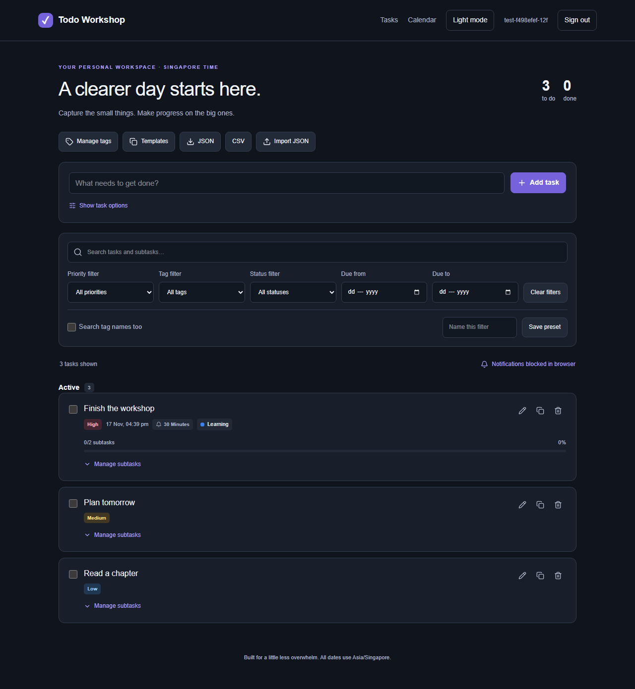

# Verification record

Date: **17 November 2026**. Local environment: Windows, Node.js 22.19.0, npm 11.13.0, Next.js 16.4.6 production build, Playwright Chromium 159, Asia/Singapore. These are observed results, not a predicted assessment score.

## Completed checks

| Check                        | Observed result                                                                                                                                                |
| ---------------------------- | -------------------------------------------------------------------------------------------------------------------------------------------------------------- |
| Production build             | Passed, including Next.js TypeScript validation and static page generation                                                                                     |
| Explicit typecheck           | Passed                                                                                                                                                         |
| ESLint                       | Passed, no warnings                                                                                                                                            |
| Formatting                   | Checked with Prettier after final documentation/evidence formatting                                                                                            |
| Unit tests                   | 24 passed                                                                                                                                                      |
| Core unit coverage           | 99.14% lines, 98.84% statements, 97.72% functions, 92.72% branches; database, filter/progress and timezone modules. This excludes UI/auth route coverage.      |
| Browser run 1                | 23 passed in 30.1 seconds                                                                                                                                      |
| Browser run 2                | 23 passed in 37.8 seconds                                                                                                                                      |
| Browser run 3                | 23 passed in 37.8 seconds                                                                                                                                      |
| Automated accessibility      | No WCAG A/AA-tagged axe violations on sampled login, desktop workspace, edit dialog, mobile dark/light workspace and calendar states                           |
| Responsive layout            | 390px viewport checked for horizontal overflow; desktop/mobile/calendar screenshots inspected                                                                  |
| Dependency audit             | `npm audit --audit-level=moderate`: zero reported vulnerabilities                                                                                              |
| Local warm authenticated API | Ten GET samples, average **7.63 ms**; this is local request round-trip time, not cloud latency                                                                 |
| Local production navigation  | Recorded load event 40.9 ms, FCP 68 ms; unthrottled local environment, not Lighthouse or TTI                                                                   |
| JavaScript bundle            | All 13 production JS files: 636,532 raw bytes, **197,201 individually gzip-compressed bytes**. Includes all routes, not a route-specific transfer measurement. |
| Filter benchmark             | 1000 tasks filtered in less than 100 ms, asserted in unit suite                                                                                                |
| Secret/database exclusion    | `.env.local`, both local databases, dependencies and build output confirmed ignored by Git                                                                     |

Raw evidence: [three-run summary](evidence/e2e-summary.json), [run 1](evidence/e2e-run-1.log), [run 2](evidence/e2e-run-2.log), [run 3](evidence/e2e-run-3.log), [coverage](evidence/coverage-summary.json), [performance](evidence/performance.json), [bundle size](evidence/bundle-size.json).

The browser tests exercise actual passkey registration and authentication using Chromium's virtual authenticator and server signature verification. Browser notifications are tested with a mocked constructor and real reminder API; an OS notification was not claimed as observed.

## Screenshots

[Login](evidence/login.png) · [Mobile workspace](evidence/mobile.png) · [Calendar](evidence/calendar.png)

## Not yet externally verified

- A live Railway deployment, HTTPS passkey registration on its final domain, and persistence across a real redeploy/restart.
- Docker image execution locally: Docker Desktop's Linux daemon was unavailable. Node production mode was tested directly. The Dockerfile and volume instructions require a deployment smoke check.
- Firefox, Safari, real mobile devices, real device passkeys, manual screen-reader testing and actual OS notification permission/delivery.
- Lighthouse accessibility score, cloud page-load/FCP/TTI scores, cold-start performance and production mutation latency. Axe scans and warm local samples do not substitute for those rubric items.
- Full manual completion of every original evaluation checkbox. The original rubric remains unchanged; use `REQUIREMENTS_TRACEABILITY.md` to locate supporting implementation/tests.

GitHub Actions is configured to run checks and three consecutive production browser passes on Linux. Its result is independently visible in the repository's Actions tab; local results above are not a claim that CI has already passed.
